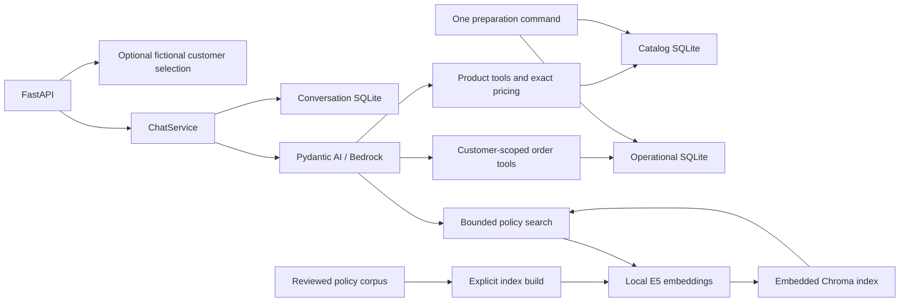

# Demo architecture

The project is one Python package. FastAPI supplies a local text API, and Pydantic AI
uses Bedrock with typed catalog, order and policy tools. SQLite stores operational
snapshots and chat history; embedded Chroma indexes the fixed policy corpus using
local E5 embeddings. This small dataset does not need distributed services, an ORM
or a generic ingestion framework.

`contracts` groups immutable values in focused modules: `chat` for request/response
values, `identity` for selected customer scope, `conversations` for owned history
and execution context, `catalog` for product search, `pricing` for quotes, and
`orders` for order projections. `base` contains shared validation types and the
frozen model base; `errors` contains application failures.

`ports` groups protocols by boundary (`chat`, `agent`, `catalog`,
`conversations`, `orders`). `ChatServicePort` lives in `ports.chat`; its implementation
lives in `application.chat`. `application.pricing` owns the pure price calculation.
Package initializers contain docstrings only; callers import each symbol directly
from its defining module, without compatibility re-exports.

`infrastructure` loads CSVs and performs parameterized SQL. `agent` owns provider
construction, persona, tool schemas and output checks. `api` composes those pieces.
Core modules do not import FastAPI, AWS, SQLite or Pydantic AI. Boundary tests import
all core modules so minimal initializers cannot hide an accidental dependency.

## Local demo selection

HTTP accepts optional `customer_id`; omitted/null means guest. Selected IDs must
exist in the operational registry on each request. No bearer tokens, resolver
protocol, or authentication framework is used. A small HTTP request schema carries
the selector; the boundary removes it from the agent request and supplies immutable
ExecutionContext dependencies. The model cannot choose scope through text or tools.

The selector is not authentication: any demo user may select any fictional customer.
Run on loopback with fictional data. Guest order calls return a selection-required
message before repository access; selected calls retain parameterized customer scoping.
No frontend selector is required. See [ADR-0007](adr/0007-simplified-demo-identity.md).

## Chat history

Use one server process and one ChatService instance. The service checks session
mode/customer matching, rejects same-session overlap with an in-memory active-ID
set, loads a bounded suffix of complete turns and invokes the agent. Session ownership is an
optional customer: null denotes guest. Loading/appending compares the selected
customer or null explicitly; changing customer/mode requires a new session. Guest
continuation relies on possession of the session ID, not individual-user identity.
A short SQLite transaction appends a complete pair under the next sequence number. There is no expected
revision, compare-and-swap or coordination between separate service instances.

Conversation schema v2 permits null owners. Older v1 files are rejected untouched;
stop the server and move the old file aside before starting a fresh history
store at the fixed path. There is no migration or automatic history deletion.

Cancellation and the deadline are checked before saving. Failed execution/append
returns an error and saves no completed turn; a failed first call may leave an empty
session. No transaction spans model work. SQLite operations are short and synchronous;
local commit can briefly block the event loop. Saved responses may be lost on the
network, so automatic retries are not deduplicated. These are documented demo limits.

The adapter sends fresh user/assistant text messages each run. Trusted identity and
session metadata travel separately as SDK dependencies, never model-controlled
arguments. Prior answers preserve references but are not current factual evidence.

## Storage paths

`paths.py` defines PROJECT_ROOT from the package's source location and the fixed
`data/catalog.sqlite3`, `data/operations.sqlite3`, `data/conversations.sqlite3`
locations. Preparation, HTTP composition and individual import commands share these
constants; environment storage paths, CLI database overrides, repeated resolution
and collision checks are removed. Low-level repositories/import functions accept
explicit absolute paths so tests can use temporary storage. No path factory or
configuration framework is needed.

## Data and tools

One preparation command refreshes catalog and operational snapshots using the
supplied files unchanged. Each import validates inputs/references before its own
transaction; the two database imports are not one cross-file transaction. Storage
checks cover expected tables/columns and simple markers, without exact SQL-definition
auditing or source fingerprints. Transactions and schema constraints still protect
writes. Conversation storage is untouched by preparation.

Catalog tools share one repository. Python calculates integer-centavo price quotes
before payable-price filtering, ordering/counting and limiting. The original price
is retained. Active, stocked products may receive one active promotion, otherwise
explicit PIX pricing. Inactive/unavailable offers do not apply. No dates are inferred.

Order tools retain a repository, not customer state. Each read validates selected
customer existence and scopes order/item/count SQL by customer identity. Foreign
and missing orders have the same result. Contacts, notes and payment methods are
excluded. Copied product references and historical totals survive catalog changes.
See [catalog](catalog.md) and [orders](orders.md).

Tools own exact price calculations; the model presents the original price,
discount and final price once. The output validator rejects blank/internal markup
and adds current-run truncation disclosures and one concise discount snapshot notice.
It rejects explicit `R$` amounts absent from current-run product prices/quotes or
order totals, using the existing single retry. Customer amounts and search bounds
do not authorize output amounts. Budget comparisons and clarifications use wording
such as “seu orçamento” without repeating the amount; they need no extra search
unless source facts are required. Assistant history and old tool results do not
establish current prices. The check does not prove correct price associations,
labels, percentages or every factual claim.
Diagnostics allow metadata only. This is not a universal semantic grounding check.

## Evidence and limits

Temporary SQLite/Chroma indexes and controlled models verify domain rules, ownership,
persistence, bounded policy retrieval wiring and failures. They do not establish live
language understanding, tool selection or policy-answer quality. [US-13 live evidence](examples/sprint-2/README.md)
records catalog/context, promotion/PIX and order behavior, including two failed
attempts and focused instruction corrections; those Sprint 2 runs did not cover
policy lookup. US-16 integrates policy search. US-17 reviewed four paired real
Portuguese conversations; the [results](examples/us-17/results.md) preserve one RAG
HTTP 500, failures in both arms on tool selection for a mixed order/return question,
and unsupported claims. This evidence does not establish general model quality or
that provisional retrieval is adequate.

[US-18 corrections](examples/us-18/README.md) enforce current-run citation provenance
even when no policy evidence exists, and reject missing tool returns for explicit
mixed order/return requests. Contextual policy guidance addresses the recorded source
ambiguities without changing ranking or the corpus. Citation provenance is a
deterministic check; semantic claim support remains a separate review. When a current
order result contains imported rows, the application appends a fixed notice that the
data is a snapshot and that estimated delivery does not establish actual receipt;
the model no longer has to use a prescribed disclosure phrase. A narrow output check
also rejects the recorded wording that tied delivery to its estimate. Neither check
establishes general answer faithfulness. The [Qwen capture](examples/us-18/results.md)
replays with the notice, but no provider call has tested the post-change code.

Policy search takes no arguments and uses the exact current user question. A bounded
local E5 check retrieves section 4.1 for the full mixed question but misses it for
the short contextual follow-up “E se eu já usei o instrumento?” because history is
not included in the query. The miss is recorded for a later context/retrieval follow-up;
retrieval optimization remains deferred. Sprint completion requires functional
behavior and honest limits, not proof that RAG beats Full Context.

The [simplification review](examples/simplification-review.md) preserves an earlier
offline-only delivery. Subsequent [closing evidence](examples/sprint-2/closure/README.md)
records the final Qwen conversations, failed Nova comparisons and a combined
correction message that preserves the same single-retry limit. Order snapshot
limits were explicit when asked, but not repeated in every answer.
These captures precede the source-only monetary-output rule; their budget echoes
are historical behavior. The updated rule has offline validation, not a new live run.

[Issue #32](https://github.com/rafaself/atf-ai-engineer-challenge/issues/32) records the
approved simplification. Earlier [ADRs](adr/README.md) preserve the implementation
history; this guide is authoritative for the current single-process demo boundary.
