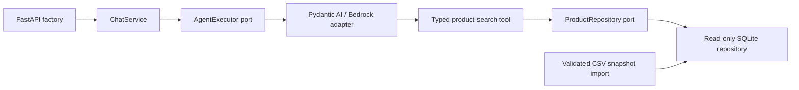

# Implemented architecture

One Python package keeps deployment simple while ports isolate replaceable
boundaries. There is no distributed service, ORM, vector store, or custom DI layer.

`contracts` owns immutable Pydantic chat/catalog values and transport-neutral
errors. `ports` owns agent/repository interfaces. `application` owns ChatService
and ChatServicePort, with no HTTP/AWS/SDK imports. `agent` owns settings, Portuguese
instructions, tool schemas, exact BRL-to-centavo conversion, provider construction
and execution/error translation. `infrastructure` owns atomic CSV ingestion and
SQLite queries. `api.app.create_app` is the composition root and transport mapper.

FastAPI dependencies expose a lazy service factory so payload validation and docs
do not resolve AWS credentials. Provider setup runs in a worker thread. The SDK
executes the synchronous catalog tool in a worker thread; the repository opens
and closes a fresh read-only connection per search. ChatService enforces a total
conversation deadline and preserves cancellation. No shared SQLite connection or
conversation history crosses requests.

## Retrieval and prompting rationale

The small structured catalog needs exact prices, stock/status rules, bounded
results, and deterministic filtering. Application-owned parameterized SQL offers
these guarantees directly. The model selects typed tool arguments; it never
constructs SQL. Category/name normalization, inclusive integer-centavo bounds,
active plus positive-stock availability, stable sorting and truncation live in
the repository. Full-snapshot replacement is documented in [catalog.md](catalog.md).

The Portuguese prompt sets tone and behavioral constraints, requiring retrieval
before catalog claims, disclosure of limited results and snapshot freshness, and
honest redirection for accessories, unsupported policies/orders and other topics.
No product names/prices/stock fixtures are embedded in instructions. A prompt is
not proof that a model follows these rules; live evaluations remain necessary.

Pydantic AI supplies typed tool schemas and provider substitution. Bedrock Nova
Micro in us-east-1 is the initial low-cost preference; access and tool behavior
were verified in the recorded live scenarios. Explicit SDK/agent limits bound
request work without promising a monetary cap. See [bedrock.md](bedrock.md).

[ADR-0001](adr/0001-modular-monolith-and-dependency-boundaries.md) and
[ADR-0002](adr/0002-llm-provider-boundary.md) record accepted offline-validated
boundaries. ADR-0002 now links the recorded live compatibility checks and the
customer-output policy revision; those checks remain specific to the evaluated model/scenarios.

## Validation strategy

Tests concentrate on exact money, availability, validation, atomic replacement,
schema ownership, literal SQL search, failure mapping, cancellation and import
boundaries. Real temporary SQLite tests catch persistence risks; typed fakes and
controlled SDK models isolate application contracts. Selected HTTP integrations
exercise the whole slice. Default tests forbid live model requests.

Controlled models select known tool arguments and return known text. These tests
prove wiring/data integrity, not natural-language interpretation, tool choice,
Portuguese answer quality, resistance to adversarial prompts, or live Bedrock
compatibility. Evaluate those with the [live example checklist](examples/README.md).

## Customer-output policy

The agent exposes distinct available-product recommendations and named-product
details, fixing availability in code for each tool. An output validator rejects
known internal/control tags with one corrective retry and appends a factual
partial-selection notice for each distinct truncated-query total in the current
run. It does not strip internal text or enforce complete semantic grounding.
See ADR-0002 and the reviewed live captures for rationale and limits.
