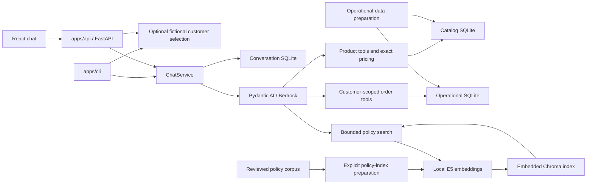

# Demo architecture

The repository is a simple modular monolith. `apps/api` owns FastAPI and serves
the React build from `apps/frontend`; `apps/cli` owns the interactive terminal
entry point. Both consume the independently installable `emporio-music` package in
`packages/emporio_music`. Pydantic AI uses Bedrock with typed catalog, order and
policy tools. SQLite stores operational snapshots and chat history; embedded
Chroma indexes the fixed policy corpus using local E5 embeddings. This small
dataset does not need distributed services, an ORM or a generic ingestion framework.

## Repository boundaries

- `packages/emporio_music/src/emporio_music/agent` owns model settings and
  construction, the persona, typed tools, execution and customer-output handling.
- `packages/emporio_music/src/emporio_music/policies` owns the frozen corpus,
  retrieval rules and local search. `infrastructure` owns the E5 and Chroma
  adapters.
- `domain` holds contracts and business invariants; `ports` defines dependency
  boundaries; `application` owns chat orchestration; `composition.py` wires the
  shared repositories and agent once for either app.
- `apps/api/src/emporio_music_api` owns HTTP schemas, routes, error mapping and
  frontend serving. `apps/cli/src/emporio_music_cli` owns terminal prompts and
  error presentation. Neither app imports the other.
- Repository-only evaluation utilities live in `scripts/`; regression tests live
  in `tests/`, with CLI-specific checks in `apps/cli/tests/`.

`domain` groups immutable values in focused modules: `chat` for request/response
values, `identity` for selected customer scope, `conversations` for owned history
and execution context, `catalog` for product search, `pricing` for quotes, and
`orders` for order projections. `base` contains shared validation types and the
frozen model base; `errors` contains application failures.

`ports` groups protocols by boundary (`chat`, `agent`, `catalog`,
`conversations`, `orders`, `policies`). `ChatServicePort` and its streaming
extension live in `ports.chat`; the implementation lives in `application.chat`.
The agent streaming port lives in `ports.agent` and keeps provider events out of
the application service. `application.pricing` owns the pure price calculation.
Package initializers contain docstrings only; callers import each symbol directly
from its defining module, without compatibility re-exports.

`infrastructure` loads CSVs and performs parameterized SQL. The agent factory owns
Bedrock configuration; the agent executor translates provider failures. Policy
search stays separate from its Pydantic AI tool wrapper. `composition.py` supplies
the shared dependency construction and customer validation used by HTTP and CLI.
FastAPI retains lazy initialization; the CLI requires `--live` for default agent
construction. Neither adapter duplicates application orchestration. Domain,
application and port modules do not import FastAPI, CLI, AWS, SQLite or Pydantic AI.
Boundary tests import all core modules so minimal initializers cannot hide an
accidental dependency.

## Local demo selection

HTTP accepts optional `customer_id`; omitted/null means guest. Selected IDs must
exist in the operational registry on each request. No bearer tokens, resolver
protocol, or authentication framework is used. A small HTTP request schema carries
the selector; the boundary removes it from the agent request and supplies immutable
ExecutionContext dependencies. The model cannot choose scope through text or tools.

The selector is not authentication: any demo user may select any fictional customer.
Run on loopback with fictional data. Guest order calls return a selection-required
message before repository access; selected calls retain parameterized customer scoping.
No frontend selector is required. See [ADR-0007](adr/0007-simplified-demo-identity.md).

## Chat history

Use one server process and one ChatService instance. The service checks session
mode/customer matching, rejects same-session overlap with an in-memory active-ID
set, loads a bounded suffix of complete turns and invokes the agent. Session ownership is an
optional customer: null denotes guest. Loading/appending compares the selected
customer or null explicitly; changing customer/mode requires a new session. Guest
continuation relies on possession of the session ID, not individual-user identity.
A short SQLite transaction appends a complete pair under the next sequence number. There is no expected
revision, compare-and-swap or coordination between separate service instances.

Conversation schema v2 permits null owners. Older v1 files are rejected untouched;
stop the server and move the old file aside before starting a fresh history
store at the fixed path. There is no migration or automatic history deletion.

Cancellation and the deadline are checked before saving. Failed execution/append
returns an error and saves no completed turn; a failed first call may leave an empty
session. No transaction spans model work. SQLite operations are short and synchronous;
local commit can briefly block the event loop. Saved responses may be lost on the
network, so automatic retries are not deduplicated. These are documented demo limits.

The adapter sends fresh user/assistant text messages each run. Trusted identity and
session metadata travel separately as SDK dependencies, never model-controlled
arguments. Prior answers preserve references but are not current factual evidence.

## Storage paths

`paths.py` reads `EMPORIO_MUSIC_DATA_DIR` once and resolves it against the process
working directory when it is relative. The default `data` directory preserves the
documented repository-root workflow and the existing `catalog.sqlite3`,
`operations.sqlite3` and `conversations.sqlite3` files. Docker sets it to
`/app/data`, which remains the persistent volume. Preparation, HTTP composition and
import commands share these constants; low-level repository/import functions
accept explicit paths so tests can use temporary storage. The API resolves the
React build through `EMPORIO_MUSIC_FRONTEND_DIR`, defaulting to
`apps/frontend/dist` from the repository root. Installed-package behavior does not
derive paths from Python source locations.

## Data and tools

The operational-data preparation command refreshes catalog and operational
snapshots using the supplied files unchanged. Each import validates
inputs/references before its own transaction; the two database imports are not one
cross-file transaction. Storage
checks cover expected tables/columns and simple markers, without exact SQL-definition
auditing or source fingerprints. Transactions and schema constraints still protect
writes. Conversation storage is untouched by preparation.

Catalog tools share one repository. Python calculates integer-centavo price quotes
before payable-price filtering, ordering/counting and limiting. The original price
is retained. Active, stocked products may receive one active promotion, otherwise
explicit PIX pricing. Inactive/unavailable offers do not apply. No dates are inferred.

Order tools retain a repository, not customer state. Each read validates selected
customer existence and scopes order/item/count SQL by customer identity. Foreign
and missing orders have the same result. Contacts, notes and payment methods are
excluded. Copied product references and historical totals survive catalog changes.
See [catalog](catalog.md) and [orders](orders.md).

Tools own exact price calculations, payable-price filtering and customer-scoped reads.
The output layer protects against blank/internal-control output and appends notices
from current tool metadata: partial lists and sources consulted. The UI and CLI
identify the fictional simulation once; per-answer snapshot/ingestion footers are
removed. Fresh operational reads are authoritative within that simulation, while
delivery estimates remain distinct from actual receipt dates.
It does not parse model prose for citations, compare every currency mention with tool
prices, or infer required tool calls from Portuguese keywords. Those gates rejected
readable citations, legitimate budget quotes and negated return requests. The model
still receives grounding and tool-use instructions; actual compliance requires
conversation review. Generated claims, prices and references are not automatically
certified by the source list. Diagnostics allow metadata only.

## Scoped return evidence

The model chooses a policy scope. Named scopes select prepared sections directly;
general queries retain E5 retrieval. Online-return evidence separates the seven-day
receipt window, required conditions, exclusions, refund facts and documented next
steps. Each assessment requires fresh policy retrieval in the instructions.
Original PDF bytes and provenance remain intact.

Answers remain model prose. A bounded return-output function was evaluated and
rejected because schema/correction failures caused HTTP errors and repeated
questions. It is not registered in the delivered runtime; the experiment and
rejected patch are retained in the model-comparison evidence. Scope selection,
customer-fact extraction, freshness and answer faithfulness still require live
conversation review. A source list does not certify generated claims.

## Evidence and limits

Temporary SQLite/Chroma indexes and controlled models verify domain rules, ownership,
persistence, bounded policy retrieval wiring and failures. They do not establish live
language understanding, tool selection or policy-answer quality. [US-13 live evidence](examples/sprint-2/README.md)
records catalog/context, promotion/PIX and order behavior, including two failed
attempts and focused instruction corrections; those Sprint 2 runs did not cover
policy lookup. US-16 integrates policy search. US-17 reviewed four paired real
Portuguese conversations; the [results](examples/us-17/results.md) preserve one RAG
HTTP 500, failures in both arms on tool selection for a mixed order/return question,
and unsupported claims. This evidence does not establish general model quality or
that provisional retrieval is adequate.

[US-18 evidence](examples/us-18/README.md) preserves the former validator failures
and the subsequent simplification. The source footer uses only successful current-run
policy returns; it lists consulted sections/pages and does not claim entailment.
The latest saved live mixed case called both tools and retained order status but
failed the former citation grammar. A controlled HTTP replay now accepts its generated
candidate without an output retry. This verifies delivery, not correction of its
policy-applicability omissions or general model quality.

Policy search takes no arguments. It combines the current user question with the
latest prior user question when the combined text is at most 256 characters; assistant
answers and tool results stay out of the retrieval query. The bounded local E5 check
missed section 4.1 for “E se eu já usei o instrumento?” alone and returned it when
the previous return question was included. An unrelated prior hours question added
section 2 to a return query, so this limited context can add irrelevant evidence.
These are retrieval observations, not answer-quality results. Broader retrieval
optimization remains deferred; sprint completion does not require RAG to beat Full
Context.

The [simplification review](examples/simplification-review.md) preserves an earlier
offline-only delivery. Subsequent [closing evidence](examples/sprint-2/closure/README.md)
records the final Qwen conversations, failed Nova comparisons and a combined
correction message that preserves the same single-retry limit. Order snapshot
limits were explicit when asked, but not repeated in every answer.
The former source-only monetary-output gate has been retired; budget references
no longer cause output retries. The captured conversations remain historical evidence.

[Issue #32](https://github.com/rafaself/atf-ai-engineer-challenge/issues/32) records the
approved simplification. Earlier [ADRs](adr/README.md) preserve the implementation
history; this guide is authoritative for the current single-process demo boundary.
