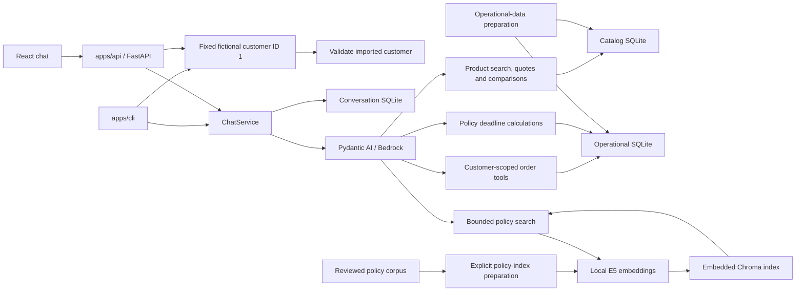

# Demo architecture

The repository is a simple modular monolith. `apps/api` owns FastAPI and serves the React build from `apps/frontend`; `apps/cli` owns the interactive terminal entry point. Both consume the independently installable `emporio-music` package in `packages/emporio_music`. Pydantic AI uses Bedrock with typed catalog, order and policy tools. SQLite stores operational snapshots and chat history; embedded Chroma indexes the fixed policy corpus using local E5 embeddings. This small dataset does not need distributed services, an ORM or a generic ingestion framework.

## Repository boundaries

- `packages/emporio_music/src/emporio_music/agent` owns model settings and construction, the persona, typed tools, execution and customer-output handling.
- `packages/emporio_music/src/emporio_music/policies` owns the frozen corpus, retrieval rules and local search. `infrastructure` owns the E5 and Chroma adapters.
- `domain` holds contracts and business invariants; `ports` defines dependency boundaries; `application` owns chat orchestration; `composition.py` wires the shared repositories and agent once for either app.
- `apps/api/src/emporio_music_api` owns HTTP schemas, routes, error mapping and frontend serving. `apps/cli/src/emporio_music_cli` owns terminal prompts and error presentation. Neither app imports the other.
- Repository-only evaluation utilities live in `scripts/`; regression tests live in `tests/`, with CLI-specific checks in `apps/cli/tests/`.

`domain` groups immutable values in focused modules: `chat` for request/response values, `identity` for fixed customer scope, `conversations` for owned history and execution context, `catalog` for product search and batch lookup, `pricing` for unit prices, `quotes` and `comparisons` for deterministic product results, `deadlines` for qualified date calculations, and `orders` for order projections. `base` contains shared validation types and the frozen model base; `errors` contains application failures.

`ports` groups protocols by boundary (`chat`, `agent`, `catalog`, `conversations`, `orders`, `policies`). `ChatServicePort` and its streaming extension live in `ports.chat`; the implementation lives in `application.chat`. The agent streaming port lives in `ports.agent` and keeps provider events out of the application service. `application.pricing` owns unit-price calculation; `application.quotes`, `application.comparisons` and `application.deadlines` own the corresponding pure calculations. Package initializers contain docstrings only; callers import each symbol directly from its defining module, without compatibility re-exports.

`infrastructure` loads CSVs and performs parameterized SQL. The agent factory owns Bedrock configuration; the agent executor translates provider failures. Policy search stays separate from its Pydantic AI tool wrapper. `composition.py` supplies shared dependency construction and fixed identity resolution for HTTP and CLI. FastAPI retains lazy initialization; the CLI requires `--live` for default agent construction. Neither adapter duplicates application orchestration. Domain, application and port modules do not import FastAPI, CLI, AWS, SQLite or Pydantic AI. Boundary tests import all core modules so minimal initializers cannot hide an accidental dependency.

## Fixed demo identity

HTTP, React chat and CLI use imported fictional customer ID `1`. Shared composition
resolves that identity on the server and checks the current operational snapshot on
each incoming turn. If the customer is absent after preparation or re-import, the
request fails with a sanitized service-unavailable response. The HTTP contract has
no `customer_id` field; including one is a 422 validation error. The browser does
not send identity data, and chat text or tool arguments cannot choose another
customer.

The trusted per-run `ExecutionContext` scopes every order tool. SQLite queries
also bind customer ID inside the repository, including exact tracking-code lookup.
This fixed fictional identity is demo context, not authentication. Run on loopback
with fictional data. See [ADR-0004](adr/0004-simplified-demo-identity.md).

## Chat history

Use one server process and one ChatService instance. The service checks session
ownership, rejects same-session overlap with an in-memory active-ID set, loads a
bounded suffix of complete turns and invokes the agent. New HTTP and CLI sessions
are owned by fixed customer ID `1`. Existing guest or other-customer sessions fail
the ownership check with the same 404 as unknown IDs; history is never reassigned.
The conversation schema still represents null owners so old guest sessions remain
inaccessible rather than being rewritten. A short SQLite transaction appends a
complete pair under the next sequence number. There is no expected revision,
compare-and-swap or coordination between separate service instances.

Conversation schema v2 permits null owners. Older v1 files are rejected untouched; stop the server and move the old file aside before starting a fresh history store at the fixed path. There is no migration or automatic history deletion.

Cancellation and the deadline are checked before saving. Failed execution/append returns an error and saves no completed turn; a failed first call may leave an empty session. No transaction spans model work. SQLite operations are short and synchronous; local commit can briefly block the event loop. Saved responses may be lost on the network, so automatic retries are not deduplicated. These are documented demo limits.

The adapter sends fresh user/assistant text messages each run. Trusted identity and session metadata travel separately as SDK dependencies, never model-controlled arguments. Prior answers preserve references but are not current factual evidence.

## Storage paths

`paths.py` reads `EMPORIO_MUSIC_DATA_DIR` once and resolves it against the process working directory when it is relative. The default `data` directory preserves the documented repository-root workflow. Catalog sources and `catalog.sqlite3` live under `catalog/`; customer/order sources and `operations.sqlite3` live under `operations/`; policy sources and the retrieval index live under `policies/`; and `conversations.sqlite3` lives under `conversations/`. Docker sets the data root to `/app/data`, which remains the persistent volume. Preparation, HTTP composition and import commands share these constants; low-level repository/import functions accept explicit paths so tests can use temporary storage. The API resolves the React build through `EMPORIO_MUSIC_FRONTEND_DIR`, defaulting to `apps/frontend/dist` from the repository root. Installed-package behavior does not derive paths from Python source locations.

## Data and tools

The operational-data preparation command refreshes catalog and operational snapshots using the supplied files unchanged. Each import validates inputs/references before its own transaction; the two database imports are not one cross-file transaction. Storage checks cover expected tables/columns and simple markers, without exact SQL-definition auditing or source fingerprints. Transactions and schema constraints still protect writes. Conversation storage is untouched by preparation.

Catalog tools share one repository. Search calculates integer-centavo unit prices before payable-price filtering, ordering/counting and limiting. Multi-product quotes and comparisons batch identified product IDs in one read-only transaction, including current promotion and stock data. Active, stocked products may receive one active promotion, otherwise explicit PIX pricing. Inactive/unavailable offers do not apply. Quotes, installment allocation and comparisons use integer centavos. Unsupported freight, mixed-payment and policy-threshold facts remain explicitly unresolved.

Order tools retain a repository, not customer state. Each read validates the fixed
customer exists and scopes order/item/count SQL by customer identity, including
exact tracking-code lookup. Foreign and missing orders or tracking codes have the
same safe result. Contacts, notes and payment methods are excluded. Copied product
references and historical totals survive catalog changes. Deadline lookups reuse
that customer-scoped repository. Stored purchase dates and estimated delivery are
distinct from dispatch, actual receipt and request dates; deadline calculations
preserve those distinctions and do not reprice orders. See [catalog](guides/catalog.md)
and [orders](guides/orders.md).

Tools own exact unit/cart calculations, payable-price filtering, numeric comparisons, qualified deadlines and customer-scoped reads. The output layer protects against blank/internal-control output and appends notices from current tool metadata: partial lists and sources consulted. The UI and CLI identify the fictional simulation once; per-answer snapshot/ingestion footers are removed. Fresh operational reads are authoritative within that simulation, while delivery estimates remain distinct from actual receipt dates. It does not parse model prose for citations, compare every currency mention with tool prices, or infer required tool calls from Portuguese keywords. Those gates rejected readable citations, legitimate budget quotes and negated return requests. The model still receives grounding and tool-use instructions; actual compliance requires conversation review. Generated claims, prices and references are not automatically certified by the source list. Diagnostics allow metadata only.

## Scoped return evidence

The model chooses a policy scope. Named scopes select prepared sections directly; general queries retain E5 retrieval. Online-return evidence separates the seven-day receipt window, required conditions, exclusions, refund facts and documented next steps. Each assessment requires fresh policy retrieval in the instructions. Original PDF bytes and provenance remain intact.

Answers remain model prose. A bounded return-output function was evaluated and rejected because schema/correction failures caused HTTP errors and repeated questions. It is not registered in the delivered runtime; the experiment and rejected patch are retained in the model-comparison evidence. Scope selection, customer-fact extraction, freshness and answer faithfulness still require live conversation review. A source list does not certify generated claims.

## Evidence and limits

Temporary SQLite/Chroma indexes and controlled models verify domain rules, ownership, persistence, bounded policy retrieval wiring and failures. They do not establish live language understanding, tool selection or policy-answer quality. The frozen [historical retrieval benchmark](https://github.com/rafaself/atf-ai-engineer-challenge/blob/9f6dcadb4981cc3dfaa6ef480576f88218fb2640/docs/benchmarks/results.md) met none of its full target sets; retrieval metrics do not establish answer quality. The [final model-selection benchmark](evaluations/model-selection/README.md) contains a bounded, unblinded AI assessment; it does not establish general model quality.

Policy search takes a model-selected policy scope, but no model-authored search query. For general-scope retrieval it combines the current question with the latest prior user question when the combined text is at most 256 characters; assistant answers and tool results stay out of the retrieval query. The bounded local E5 check missed section 4.1 for “E se eu já usei o instrumento?” alone and returned it when the previous return question was included. An unrelated prior hours question added section 2 to a return query, so this limited context can add irrelevant evidence. These are retrieval observations, not answer-quality results. Broader retrieval optimization remains deferred; sprint completion does not require RAG to beat Full Context.

[Issue #32](https://github.com/rafaself/atf-ai-engineer-challenge/issues/32) records the approved simplification. Earlier [ADRs](adr/README.md) preserve the implementation history; this guide is authoritative for the current single-process demo boundary.
