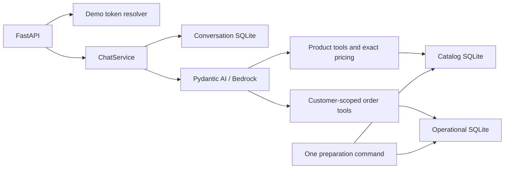

# Demo architecture

The project is one Python package. FastAPI supplies a local text API, Pydantic AI
supplies typed tool calling, Bedrock supplies the model, and SQLite stores source
snapshots and chat history. The small dataset does not need distributed services,
a vector store, an ORM or a generic ingestion framework.

`contracts` holds immutable values; small ports describe the agent and repository
boundaries used by typed tests. `application` owns chat execution and the pure
pricing function. `infrastructure` loads CSVs and performs parameterized SQL.
`agent` owns provider construction, persona, tool schemas and output checks.
`api` composes those pieces. Core modules do not import FastAPI, AWS or Pydantic AI.

## Chat history

Use one server process and one ChatService instance. The service checks session
ownership, rejects same-session overlap with an in-memory active-ID set, loads a
bounded suffix of complete turns and invokes the agent. A short SQLite transaction
appends a complete pair under the next sequence number. There is no expected
revision, compare-and-swap or coordination between separate service instances.

Cancellation and the deadline are checked before saving. Failed execution/append
returns an error and saves no completed turn; a failed first call may leave an empty
session. No transaction spans model work. SQLite operations are short and synchronous;
local commit can briefly block the event loop. Saved responses may be lost on the
network, so automatic retries are not deduplicated. These are documented demo limits.

The adapter sends fresh user/assistant text messages each run. Trusted identity and
session metadata travel separately as SDK dependencies, never model-controlled
arguments. Prior answers preserve references but are not current factual evidence.

## Data and tools

One preparation command refreshes catalog and operational snapshots using the
supplied files unchanged. Each import validates inputs/references before its own
transaction; the two database imports are not one cross-file transaction. Storage
checks cover expected tables/columns and simple markers, without exact SQL-definition
auditing or source fingerprints. Transactions and schema constraints still protect
writes. Conversation storage is untouched by preparation.

Catalog tools share one repository. Python calculates integer-centavo price quotes
before payable-price filtering, ordering/counting and limiting. The original price
is retained. Active, stocked products may receive one active promotion, otherwise
explicit PIX pricing. Inactive/unavailable offers do not apply. No dates are inferred.

Order tools retain a repository, not customer state. Each read validates trusted
customer existence and scopes order/item/count SQL by customer identity. Foreign
and missing orders have the same result. Contacts, notes and payment methods are
excluded. Copied product references and historical totals survive catalog changes.
See [catalog](catalog.md) and [orders](orders.md).

The output validator rejects blank/internal markup and adds current-run truncation
and price disclosures. Discounted products share one concise snapshot notice.
Diagnostics allow metadata only. This is not a universal semantic grounding check.

## Evidence and limits

Real temporary SQLite and controlled models verify domain rules, ownership,
persistence, concurrent independent chats and failures. They do not establish live
language understanding or tool selection. General policy lookup and fresh reviewed
Bedrock conversations remain unfinished.

[Issue #32](https://github.com/rafaself/atf-ai-engineer-challenge/issues/32) records the
approved simplification. Earlier [ADRs](adr/README.md) preserve the implementation
history; this guide is authoritative for the current single-process demo boundary.
