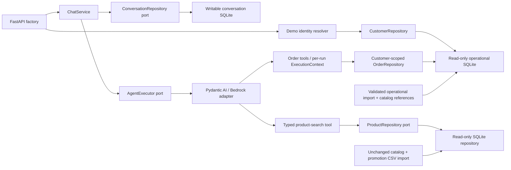

# Implemented architecture

One Python package keeps deployment simple while ports isolate replaceable
boundaries. There is no distributed service, ORM, vector store, or custom DI layer.

`contracts` owns immutable Pydantic chat/catalog/order values and transport-neutral
errors. `ports` owns agent/repository interfaces. `application` owns ChatService
and ChatServicePort plus the pure pricing function, with no HTTP/AWS/SDK imports. `agent` owns settings, Portuguese
instructions, tool schemas, exact BRL-to-centavo conversion, provider construction
and execution/error translation. `infrastructure` owns atomic CSV ingestion and
SQLite queries. `api.app.create_app` is the composition root and transport mapper.

FastAPI dependencies expose a lazy service factory so payload validation and docs
do not resolve AWS credentials. Provider setup runs in a worker thread. The SDK
executes the synchronous catalog tool in a worker thread; the repository opens
and closes a fresh read-only connection per search. HTTP resolves a server-configured
demo token into trusted identity by validating imported customer existence before
constructing the service or accessing sessions/model.
ChatService requires identity-only context, creates or loads an owned session, loads
bounded completed turns, invokes AgentExecutor, and commits before returning a
ChatResponse with its session ID. UUID possession never establishes ownership.

The conversation adapter owns a separate writable SQLite file. A complete turn and
expected-revision increment commit together. No transaction spans model execution;
each operation owns its connection. Short synchronous operations with zero SQLite
busy wait prevent asynchronous worker appends after cancellation. The deadline is
checked before the final non-awaiting commit; local filesystem commit cannot be
interrupted and may briefly block the event loop. A per-service active-ID guard
rejects same-session overlap, while revision checks reject stale commits across
instances. The supported deployment is a single process/event loop on loopback.

History is a bounded suffix of complete user/assistant text pairs; all turns remain
on disk until local reset. The provider adapter constructs fresh SDK messages per
invocation without identity/session metadata or historical tool returns. No history
or identity is cached on the executor. AgentResponse contains the generated answer;
ChatService supplies the durable session ID only after successful append.

[ADR-0003](adr/0003-owned-conversation-execution-context.md) records the original
trust contracts; [ADR-0004](adr/0004-persistent-conversation-turns.md) records their
persistent implementation and response-loss limits. [ADR-0005](adr/0005-authorized-operational-snapshots.md)
records the US-11 operational snapshot, customer validation and read-only order
authorization. No compatibility shim, generic repository
framework, distributed coordination, or new production dependency is introduced.

## Retrieval and prompting rationale

The small structured catalog needs exact prices, stock/status rules, bounded
results, and deterministic filtering. Application-owned retrieval and exact pricing code provide these guarantees. The model selects typed tool arguments; it never
constructs SQL. Category/name normalization, inclusive integer-centavo bounds,
active plus positive-stock availability, stable sorting and truncation live in
the repository. Products and active promotions share one SQL snapshot; Python
calculates exact quotes before payable-price filtering, ordering and limiting.
Full-snapshot replacement is documented in [catalog.md](catalog.md).

The Portuguese prompt sets tone and behavioral constraints, requiring retrieval
before catalog claims, disclosure of limited results and snapshot freshness, and
honest redirection for accessories, unsupported policies and other topics.
Prior answers supply conversational references rather than authoritative mutable
facts; the instructions require a fresh tool lookup for price/stock/order follow-ups.
No product names/prices/stock fixtures are embedded in instructions. A prompt is
not proof that a model follows these rules; live evaluations remain necessary.

Pydantic AI supplies typed tool schemas and provider substitution. Bedrock Nova
Micro in us-east-1 is the initial low-cost preference; access and tool behavior
were verified in the recorded live scenarios. Explicit SDK/agent limits bound
request work without promising a monetary cap. See [bedrock.md](bedrock.md).

[ADR-0001](adr/0001-modular-monolith-and-dependency-boundaries.md) and
[ADR-0002](adr/0002-llm-provider-boundary.md) record accepted offline-validated
boundaries. ADR-0002 now links the recorded live compatibility checks and the
customer-output policy revision; those checks remain specific to the evaluated model/scenarios.

## Promotions using immutable sources

US-12 extends the existing catalog import/schema with all original promotion rows;
source files are read-only, and no dates or values are invented. One pure application
function applies an eligible active promotion, otherwise explicitly requested PIX,
using integer-centavo half-up arithmetic with no stacking. Stored original prices
and historical orders are unchanged. Product tools expose payment selection and
promotion filtering, with typed original/final price evidence. The output validator
appends current-run discount disclosures as well as truncation notices. No separate
database, date subsystem, policy RAG or production dependency is added.
See [catalog pricing](catalog.md) and [ADR-0006](adr/0006-immutable-promotion-pricing.md).

## Customer-order boundary

The full HTTP composition shares product tools with isolated catalog probes and
adds two read-only order tools. Catalog-only probes are never a runtime fallback.
Three distinct storage paths are required: catalog, operations and conversations.
The explicit operational importer validates complete sources before an atomic full
replacement, retaining customer IDs only, minimal orders, quantities and copied
catalog product IDs/names. It records source hashes plus a logical reference hash.
Contacts, customer names/cities, notes and payment fields are excluded. Historical
totals remain exact supplied centavos; current prices never reconstruct unit prices.
See [operational data and tools](orders.md).

The token resolver validates every mapped customer initially and rechecks the
matched one after re-import. Each repository read separately checks trusted customer
existence and scopes order/item/count SQL using parameters inside one read transaction.
Unknown/foreign order IDs are indistinguishable; known empty accounts succeed while
storage faults fail explicitly. SDK per-run dependencies carry ExecutionContext;
model messages do not contain trusted identity/session metadata. Cached tools retain
repositories, without mutable per-customer state. Results include snapshot basis,
counts and bounded ordering, with current-run truncation notices for lists/items.

No component claims production authentication, live carrier status, actual receipt,
payment confirmation or return eligibility. Prompts require fresh order retrieval;
controlled models prove data flow and SQL isolation, not semantic adherence.

## Validation strategy

Tests concentrate on exact money, availability, validation, atomic replacement,
schema ownership, literal SQL search, failure mapping, cancellation and import
boundaries. Real temporary SQLite tests catch persistence risks; typed fakes and
controlled SDK models isolate application contracts. Selected HTTP integrations
exercise the whole slice. Default tests forbid live model requests.

Controlled models select known tool arguments and return known text. These tests
prove wiring/data integrity, not natural-language interpretation, tool choice,
Portuguese answer quality, resistance to adversarial prompts, or live Bedrock
compatibility. Evaluate those with the [live example checklist](examples/README.md).

## Customer-output policy

The agent exposes distinct available-product recommendations and named-product
details, fixing availability in code for each tool. An output validator rejects
known internal/control tags with one corrective retry and appends a factual
partial-selection notice for each distinct truncated-query total in the current
run, selected by SDK message run ID. It does not strip internal text or enforce
complete semantic grounding.
See ADR-0002 and the reviewed live captures for rationale and limits.

Diagnostics use per-event metadata allowlists: no raw chat text, answers, history,
query text, identifiers, credentials, paths, or tool rows. Configuration exposes
private demo-token mapping and history limits explicitly; see the [API guide](api.md).
